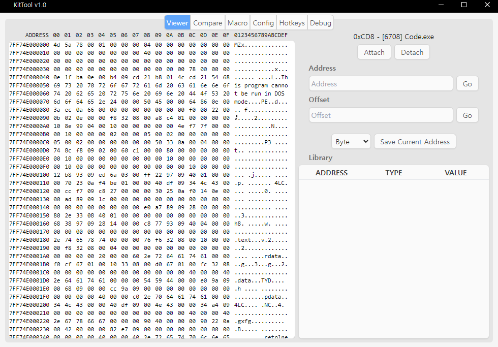
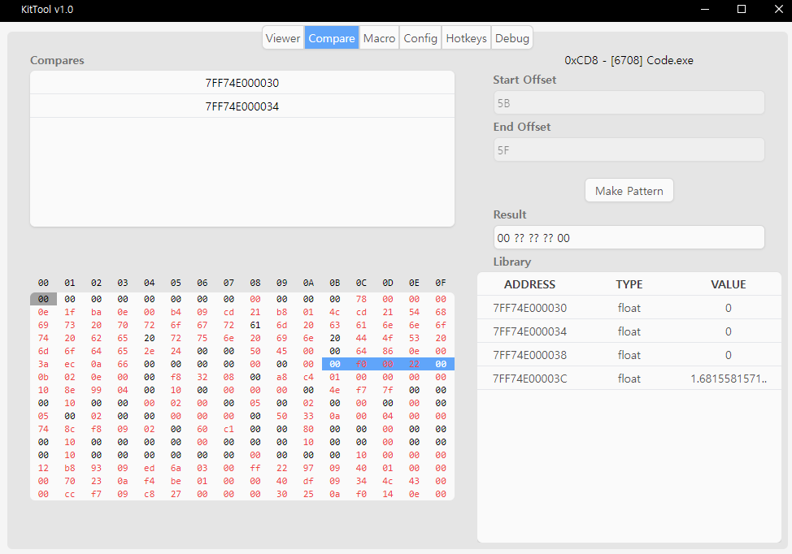
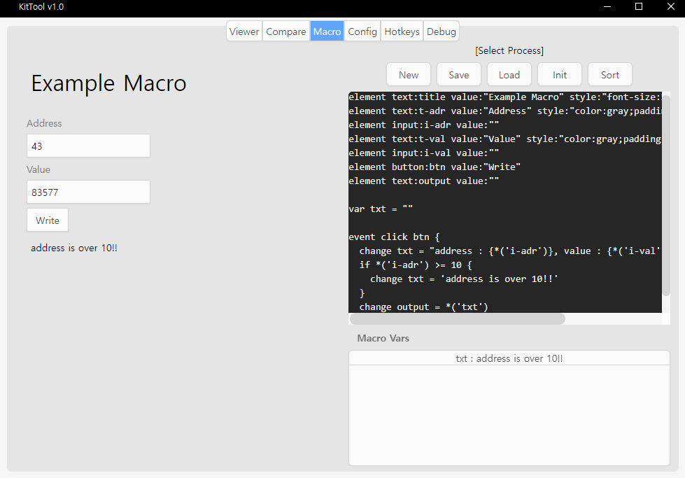

# KitTool

A lightweight Windows memory analyzer and macro runtime: attach to a running process, inspect and edit its memory from an Electron UI, and script reactive macros with the built-in KTS language.

[](LICENSE)
[](https://www.electronjs.org/)
[](https://github.com/Rob--/memoryjs)
[](https://www.typescriptlang.org/)

**Status:** Maintained — feature-complete for its original scope (viewer, compare, macro, config); no automated tests.

## Features

- **Viewer** — attach to a process, scroll a hex dump, jump to an address or offset (simple `+ - * /` expressions accepted), switch byte / int32 / float / double interpretation, save addresses to a library, and write values back through an editor dialog.
- **Compare** — collect addresses from the library, diff their bytes side-by-side with changed regions highlighted, and generate Frida-style `AA BB ?? ??` patterns from a selected range.
- **Macro** — write KTS scripts in an in-app editor (bracket/quote auto-pairing), load/save `.kts` files, and run `init` / `loop` / `click` / `keydown` / `keyup` events that read, compare, and write memory.
- **Config** — tune the viewer refresh rate and macro loop tick; values persist in Electron's `userData` directory.
- **Hotkeys** — keyboard shortcuts for every common action (see below).

| Viewer | Compare | Macro |
|---|---|---|
|  |  |  |

## How it works

- `src/index.ts` is the Electron main process. It owns the `memoryjs` process handle, exposes `readMemory` / `writeMemory` / `readBuffer` / `writeBuffer` and process-list IPC handlers, parses KTS scripts, and persists `config.json`.
- `src/preload.ts` bridges `ipcRenderer` into the renderer as `emit` / `on` helpers.
- `src/main.ts` is the renderer: it builds the viewer, library, compare, macro, and config panes in `public/main.html`, drives the refresh loop, and executes macro events against the live variable table.
- Styling is Tailwind compiled from `public/global.css` into `public/output.css`.

## Tech stack

- Runtime/Language: Node.js, TypeScript 5.4, Electron 30
- Memory access: [`memoryjs`](https://github.com/Rob--/memoryjs) (native add-on, Windows only)
- UI: plain DOM + Tailwind CSS 3.4
- Tooling: `tsc`, `concurrently`, `electron-builder` (NSIS installer), GitHub Actions CI (`.github/workflows/ci.yml`, Windows runner)

## Getting started

### Requirements

- Windows 10 or later (x64) — `memoryjs` does not build or load on macOS/Linux
- Node.js 18+ and npm
- Visual Studio Build Tools (needed to compile `memoryjs` on install)

### Install

```bash
git clone https://github.com/eunhhu/KitTool.git
cd KitTool
npm install
```

### Run

```bash
npm run build      # tsc + tailwind -> dist/, public/output.css
npm start          # electron .
npm run dev        # tsc --watch + tailwind --watch (run `npm start` in another terminal)
npm run typecheck  # tsc --noEmit
npm run dist       # build + electron-builder -> NSIS installer under build/
```

## Using the app

1. Click **Attach** (<kbd>Alt</kbd>+<kbd>A</kbd>), filter the process list by name, and double-click a process.
2. In **Viewer**, scroll the hex dump, type a hex address into **Address** to jump, and press <kbd>Ctrl</kbd>+<kbd>S</kbd> to save the selection to the library. Double-click a library entry (or <kbd>Enter</kbd>) to open the value editor and write a new value.
3. In **Compare**, press <kbd>Ctrl</kbd>+<kbd>T</kbd> on library entries to add them, drag a range, and click **Make Pattern**.
4. In **Macro**, write a KTS script and press <kbd>Ctrl</kbd>+<kbd>Enter</kbd> (**Init**). **Sort** pretty-prints and reorders declarations (elements → vars → events); **Save**/**Load** use plain-text `.kts` files.
5. Click **Detach** (<kbd>Alt</kbd>+<kbd>D</kbd>) to release the handle.

### Hotkeys

| Scope | Keys | Action |
|---|---|---|
| Global | <kbd>Alt</kbd>+<kbd>A</kbd> / <kbd>Alt</kbd>+<kbd>D</kbd> | Attach dialog / detach |
| Global | <kbd>Alt</kbd>+<kbd>1</kbd>..<kbd>6</kbd> | Switch tab (Viewer / Compare / Macro / Config / Hotkeys / Debug) |
| Viewer | <kbd>Ctrl</kbd>+<kbd>1</kbd>..<kbd>4</kbd> | View type (byte / int / float / double) |
| Viewer | <kbd>Ctrl</kbd>+<kbd>S</kbd> / <kbd>Ctrl</kbd>+<kbd>C</kbd> | Save selection to library / copy bytes |
| Library | <kbd>↑</kbd> <kbd>↓</kbd> <kbd>Enter</kbd> <kbd>Delete</kbd> | Move / open editor / remove |
| Library | <kbd>Ctrl</kbd>+<kbd>G</kbd> / <kbd>Ctrl</kbd>+<kbd>T</kbd> | Go to address / add to Compares |
| Editor | <kbd>Enter</kbd> or <kbd>Ctrl</kbd>+<kbd>W</kbd> / <kbd>Ctrl</kbd>+<kbd>S</kbd> | Write value / save to library |
| Macro editor | <kbd>Ctrl</kbd>+<kbd>Enter</kbd> | Init the macro |

## KTS language reference

A KTS script is a list of declarations; lines starting with `#` are comments.

```kts
element <type>:<id> value:"..." style:"..."   # type: text | input | button
var <name> = <value>                           # evaluated as a JavaScript literal
event <type> <target?> { ... }                 # type: init | loop | click | keydown | keyup
```

Commands inside an event body:

```kts
change <name> = <evalValue>                    # set a var or an input/text element value
write  <address> = <evalValue> as <valueType>  # valueType: byte | int | float | double
if <evalValue> <op> <evalValue> { ... }        # op: == != >= <= > <
```

An *evaluated value* is a JavaScript expression (run inside an isolated `new Function(...)`) or a template string with `{...}` sections. Built-in modifiers can be chained by concatenation (`fi(x)` = read a float at the address parsed from hex string `x`):

| Modifier | Meaning |
|---|---|
| `s` / `n` / `b` | `String(v)` / `Number(v)` / `v === 'true'` |
| `x` / `i` | `v.toString(16)` / `parseInt(v, 16)` |
| `*` | look up a variable or element by id |
| `1` / `4` / `f` / `d` | read 1 byte / int32 / float / double at address |

Example:

```kts
element text:score   value:"0"
element button:reset value:"Reset"

var base = 0x7FF74E000000

event loop {
  change score = fi("{x(*('base') + 0x20)}")
}

event click reset {
  write i*('base') + 0x20 = 0 as int
}
```

## Project structure

```text
src/
  index.ts        Electron main process, memoryjs access, IPC handlers, KTS parser, config persistence
  main.ts         renderer: UI panes, refresh loop, macro runtime
  preload.ts      ipcRenderer bridge
  types.d.ts      shared types (macro AST, value types)
  memoryjs.d.ts   memoryjs type declarations
public/           main.html, Tailwind source (global.css), compiled output.css, icons
imgs/             screenshots used in this README
.github/workflows/ci.yml  typecheck + build on windows-latest
```

## Configuration

No environment variables are read. Runtime settings (viewer refresh interval, macro tick) are stored in `config.json` under Electron's `app.getPath('userData')`; delete the file to restore the defaults (viewer `500 ms`, macro tick `1000 / 60 ms`).

## Contributing

Run `npm run typecheck` before opening a PR, and regenerate `public/output.css` with `npm run build:css` if you change CSS classes.

## License

[ISC](LICENSE). Intended for research and educational use on software you own or are authorized to modify.
